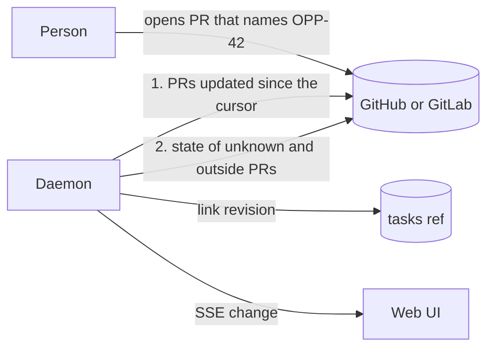

# Link new pull requests and read their state in the daemon

[[./00136-track-the-pull-requests-and-merg.md]] records the pull requests of a task in the front matter field `pull_requests`. A person or an agent writes that field. This task adds the daemon work. The daemon links a pull request that a person opens, and it reads the state of each linked pull request.

In this task, "pull request" also means a GitLab merge request.

One poll reads what changed in the project repository. A second query reads only the pull requests that the first cannot see.

## The poll

- A thread for each project, started in `Project::start` next to the sync loop, polls every two minutes. A write that links a pull request with no known state brings the poll forward.
- Query 1 reads the pull requests of the project repository that changed since the cursor: `search(type: ISSUE, query: "repo:<repo> is:pr updated:>=<cursor - 5 min>")` on GitHub, and `mergeRequests(updatedAfter: <cursor - 5 min>)` on GitLab. Its cost does not grow with the number of links, and it is usually empty. The five-minute overlap covers the lag of the GitHub search index.
- Query 2 reads each linked pull request whose state the daemon does not know, and each open or draft pull request in another repository. It uses one alias for each pull request in a single GraphQL query. At start, it reads every linked pull request once.
- Run `gh api graphql` or `glab api graphql` as subprocesses, with a timeout and no prompt. They use the login of the person, so the daemon keeps no token.
- Keep the states in memory. Do not store the state, the title, or the checks in the task. When a state changes, publish `task_changed` for each task that links the pull request, so the web UI fetches again.

## The daemon finds new pull requests

A person opens pull requests too, and an agent can forget the skill step of OPP-136. Query 1 also finds new pull requests.

- A pull request names a task when its head branch or its title has the key, for example `opp-42-fix-parser` or `Fix the parser (OPP-42)`. Match the key without case, on word boundaries. Do not read the body, because a body often names other tasks in passing.
- Link only a pull request that the logged-in person opened. Each person's daemon links their own pull requests, so two daemons do not write the same link, and the revision names the author of the pull request.
- Keep a cursor for each project in the daemon home (`pull-requests.json`). The daemon links a pull request only once, when it is new. When a person removes a link, the scan does not add it again.
- On the first scan of a project, set the cursor to the current time. Do not link old pull requests.
- The daemon writes the link as a normal revision. The author is the git user, and `via` is `openplan-daemon`.
- When `gh` or `glab` is not installed or not logged in, and the project links a pull request on that forge, the project gets the fault `pull_request_states`. Its message gives the command to run.

## API

- `PullRequestView` gains `status`. It is `{ state, title, updated_at }`, or absent when the daemon does not know the state. `state` is `open`, `draft`, `merged`, or `closed`.
- Run `mise run generate-web-client`.

## CLI

`openplan tasks show` prints one line for each pull request: the address, the state, and the title. When the daemon does not know the state, it prints the address only. The address stays, because an agent merges the pull requests that `show` prints.

## Web UI

- Each row of the "Pull requests" section gains the title and a state chip.
- The pull request icon on a task list row takes the color of the state of the newest pull request.
- When `gh` or `glab` is not installed or not logged in, the rows show with no state, and the fault control tells the person which command to run (`gh auth login`).
- The daemon never changes the status of a task, because one merged pull request can finish only part of a task. When every linked pull request is merged and the status is not `done` or `cancelled`, the "Pull requests" section on the task page shows "All pull requests merged" and a "Set done" button.

## Tests

In `tests/` directories only. Put a fake `gh` on `PATH`.

- `op-server`: the scan links a new pull request once, and not again after a remove. The first scan links no old pull request. The scan does not link a pull request of another author. The poll publishes a change. A missing `gh` gives the fault.
- `op-forge`: the queries and the parse of their answers.

## Acceptance

- A pull request with `OPP-42` in its title links itself to OPP-42 within one scan.
- `openplan tasks show OPP-42` prints each pull request with its state.
- A merged pull request shows as merged within two minutes, with no reload.
- With no `gh`, the links show with no state and the project page says how to enable the states.

## Comments

### 2026-11-13T00:28:06Z by Milan Suk via claude-code

> Not checked against a real GitLab, because no glab was available. The GitLab queries follow the GitLab GraphQL schema and have only parse tests.
